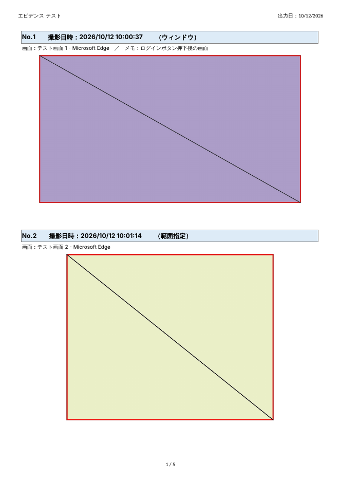

# エビデンス取得ツール

いつもどおり PrtSc や Win+Shift+S でスクリーンショットを撮るだけで、撮影日時入りのエビデンス Excel が自動でできあがる Windows 用ツールです。タスクトレイに常駐し、テストのエビデンス取得や操作手順の記録に使えます。



## ダウンロード

[Releases](../../releases/latest) から `EvidenceTool-vX.X.X.zip` をダウンロードして解凍し、`EvidenceTool.exe` を起動するだけです。インストールや Python は不要です。詳しくは zip に入っている `使い方ガイド.pdf` を見てください。

- 動作環境：Windows 10 / 11、Excel または WPS Spreadsheets など xlsx が開ける表計算ソフト
- 初回起動時に「Windows によって PC が保護されました」と出た場合は、「詳細情報」→「実行」を押してください（コード署名をしていないため表示されます）。

## 基本の流れ

0. 最初に、タスクトレイのアイコンを右クリック →「保存先を設定…」で保存先フォルダを選ぶ。選んだフォルダは覚えておき、次回起動時もそのまま使います（未設定なら `ドキュメント\エビデンス`）。
1. タスクトレイのアイコンを右クリック →「● 監視を開始」（アイコンのダブルクリックでも可）。アイコンが灰色から緑になります。
2. 作業しながら、いつもどおり **PrtSc・Alt+PrtSc・Win+Shift+S** でスクショを撮る。撮るたびに保存フォルダへ JPG で保存され、アイコンの赤い数字が増えます。
3. 終わったら右クリック →「■ 監視を終了」。
4. 右クリック →「Excel 出力」で、撮った画像が整形された Excel が開きます。

監視していない間は、スクショを撮っても保存されません。監視の開始前からクリップボードにあった画像も取り込みません。

## 撮り方

| 操作 | キー | 内容 |
|---|---|---|
| Windows 標準のスクショ | PrtSc / Alt+PrtSc / Win+Shift+S など | クリップボードに入った画像を取り込む（Win+Shift+S は範囲を選び終えた時点） |
| 全画面 | Ctrl+Alt+1 | マウスカーソルのあるモニター全体 |
| アクティブウィンドウ | Ctrl+Alt+2 | いま操作しているウィンドウだけ |
| 範囲指定 | Ctrl+Alt+3 | 画面が暗くなるので、ドラッグで範囲を選択（Esc / 右クリックで中止） |
| Excel 出力 | Ctrl+Alt+E | 監視を終了したあとに使える |

画像をコピーしただけ（ブラウザで画像をコピーした場合など）でも取り込まれます。標準のスクショを取り込みたくないときは、トレイメニューの「PrtSc・Win+Shift+S の画像も取り込む」のチェックを外してください。

トレイメニューにはほかに「過去の撮影フォルダから Excel 出力…」（以前の撮影フォルダを選んで Excel を作り直す）、「直前の1枚を取り消す」「撮影時にメモを入力する」「保存フォルダを開く」「ツールを終了」があります。

## 出力される Excel

- 「エビデンス」シート：1ページに2枚ずつ、各画像の上に **No. と撮影日時（秒まで）・撮影種別**、その下に画面（ウィンドウ名）とメモを記載します。
- 開くと **改ページプレビュー** で表示され、ページ区切りはあらかじめ設定済みです。A4縦・横1ページに収まる設定・ページ番号付きなので、そのまま印刷や PDF 化ができます。
- 画像は縦横比を保ったまま枠付きで中央に配置されます（元の解像度のまま埋め込むので拡大しても読めます）。
- 「一覧」シート：撮影の一覧。No. をクリックするとその画像の位置へ移動します。

見た目は `sample/サンプル出力.xlsx` と `sample/サンプル出力_印刷イメージ.pdf` で確認できます。

## 保存場所

設定した保存先（未設定なら `ドキュメント\エビデンス`）の下の `<監視開始日時>\` フォルダに、撮影画像（`0001_20261012_104012.jpg` の形式）、`session.json`、出力した Excel が入ります。「監視を開始」するたびに新しいフォルダになります。

Excel 出力前にツールが終了しても画像と `session.json` は残るので、トレイメニューの「過去の撮影フォルダから Excel 出力…」で後から Excel を作れます。

## 自分でビルドする（開発者向け）

### A. exe を作る

1. Python 3.10 以降をインストール（インストール時に「Add python.exe to PATH」にチェック）
2. このフォルダの `build.bat` をダブルクリック
3. `dist\EvidenceTool.exe` ができるので、好きな場所に置いて起動

`v1.0.0` のようなタグを push するか、Actions の「Build EvidenceTool.exe」をバージョンを入れて手動実行すると、GitHub Actions が exe と使い方ガイドを zip にまとめて Releases に公開します。

Windows 起動時に自動で常駐させたい場合は、`Win+R` → `shell:startup` で開くフォルダに `EvidenceTool.exe` のショートカットを置いてください。

### B. Python から直接起動する

```
pip install -r requirements.txt
```

のあと `run.bat` をダブルクリック。

## 設定（config.json）

初回起動時に exe（または evidence_tool.py）と同じフォルダに `config.json` が作られます。編集後にツールを再起動すると反映されます。中身は `config.sample.json` と同じです。

| 項目 | 説明 |
|---|---|
| `output_dir` | 保存先フォルダ。トレイメニューの「保存先を設定…」で選ぶと自動で書き込まれる。空欄なら `ドキュメント\エビデンス` |
| `hotkeys` | ホットキー。`Ctrl` `Alt` `Shift` `Win` と、英数字・`F1`〜`F12`・`PrintScreen` などを `+` でつなぐ。空欄で無効 |
| `fullscreen_scope` | `monitor`＝カーソルのあるモニターのみ、`all`＝全モニターをつなげて撮影 |
| `ask_comment` | `true` にすると撮影のたびにメモ入力欄が出る（トレイメニューからも切替可） |
| `notify` | 撮影時の通知を出すか |
| `jpeg_quality` | 保存する JPG の画質（1〜100、既定 90） |
| `watch_clipboard` | `true` なら PrtSc・Alt+PrtSc・Win+Shift+S などの標準スクショも取り込む |
| `excel.paper` | `A4` / `A3` / `B4` |
| `excel.orientation` | `portrait`（縦）/ `landscape`（横） |
| `excel.per_page` | 1ページに載せる画像の枚数（1〜） |

## 補足

- アクティブウィンドウ撮影はホットキー専用です（メニューを開いた時点でアクティブなのがタスクバーになるため）。
- ホットキーが他のアプリと重なっている場合は、起動時に「登録できませんでした」と通知されます。`config.json` で別のキーに変更してください。
- 出力先の Excel を開いたまま再出力した場合は、`_1` などを付けた別名で保存されます。

## ライセンス

MIT License（[LICENSE](LICENSE)）
